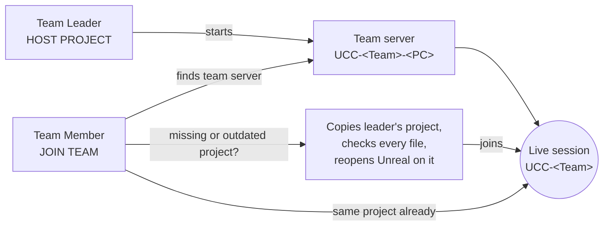

# Unreal Classroom Connect

**One-click team collaboration for Unreal Engine classrooms.** Students pick their team color, choose *Team Leader* or *Team Member*, and press one button. The leader's computer hosts the team; teammates receive the leader's project automatically and edit the same level together, live.

It is built entirely on Unreal's own **Multi-User Editing** (Concert). There is no cloud service, no accounts and no central server, and students need no administrator rights. Nothing changes the engine, firewall rules or Windows settings.

| | |
| --- | --- |
| **Engine** | Unreal Engine 5.8 (tested on 5.8.4, changelist 58902052) |
| **Platform** | Windows 10/11, 64-bit; editor only (nothing is added to packaged games) |
| **Version** | 0.5.0, development build |
| **Code** | [`ClassroomConnect/`](ClassroomConnect/) |

## How it works



1. **Leader:** opens the team project and a saved level, picks the team tile, presses **HOST PROJECT**. Classroom Connect checks that nobody else hosts that color, starts this computer's Multi-User server and creates the team session.
2. **Members:** open *any* project, pick the same tile, press **JOIN TEAM**. If they don't have the leader's exact project, it is copied over the same network connection Multi-User uses. Only missing files are copied, every file is checked by SHA-256, and the copy goes into a new folder, so nothing is overwritten. Unreal then reopens on the copy, in the leader's level, already joined.
3. **Working together:** each student gets their own marker color. Teammates in the same level appear with a large colored arrow and their name, which grows with distance so it stays readable on big maps. **Connected Students** lists everyone, and **Go To** jumps to a teammate.
4. **Finishing:** when the leader presses **End Session** (or closes Unreal), Classroom Connect saves every changed asset and writes the team's work into the leader's project first. There is no "persist changes?" question whose *No* would throw the work away.

## Features

- 20 color-coded teams (customizable with `Config/ClassroomTeams.json`), Team Leader / Team Member roles, one primary button
- Automatic, verified project copy to members, with reuse of identical files and an incremental update when the leader's project changes
- Distinct presence colors per student, large name markers, Go To teammate
- Leader auto-save on leave and on close, so team work is never lost to a prompt
- Optional **join code** per team: only editors with the same code can find the team server or copy the project
- Plain-language status and errors, a diagnostics panel, and console commands for support staff (`UCC.Host`, `UCC.Join`, `UCC.Leave`, `UCC.Status`)
- Classroom deployment: a no-admin per-student installer, an IT script that installs on every lab computer at once, a log collector, and a read-only firewall check
- Fab Marketplace packaging script (code plugin, compile-checked)

## Status

Only results that were actually observed are reported. See [TESTING.md](ClassroomConnect/TESTING.md) for the evidence and [ROADMAP.md](ClassroomConnect/ROADMAP.md) for milestones.

| Area | Status |
| --- | --- |
| Plugin builds and loads in UE 5.8.4 | ✅ Verified |
| Host, join, marker colors, leader save, project copy, join codes | ✅ Verified with headless editors on one computer |
| Window used interactively | ✅ Host and join from the window on one computer |
| Two lab computers | ⛔ Blocked by the lab's firewall policy until IT adds an inbound rule ([NETWORK.md](ClassroomConnect/Docs/NETWORK.md)) |
| Full classroom test (5 teams) | 📋 Planned ([CLASSROOM-TEST.md](ClassroomConnect/Docs/CLASSROOM-TEST.md)) |
| Which asset edits synchronize | Not yet recorded |

## Install (no GitHub knowledge needed)

**From Fab** (once the listing is live): **Add to My Library** on Fab → in the Epic Games Launcher, **Library → Fab Library → Classroom Connect → Install to Engine** (5.8) → open your project → **Edit → Plugins** → search *Classroom Connect* → tick it → **Restart Now**. Unreal's Multi-User Editing is switched on automatically. Then click **Classroom** on the toolbar.

**Direct download** (Unreal Engine 5.8.4 on Windows; no administrator needed):
1. Open the [latest release](https://github.com/nsguinn/ClassroomConnect/releases/latest) and download **`ClassroomConnect-<version>-UE5.8.4-Win64.zip`** (under *Assets*).
2. Unzip it, then double-click **`Install Classroom Connect (this user).cmd`**.
3. Quit the Epic Games Launcher completely (right-click its icon by the clock → **Exit**), then open your project. The **Classroom** button is on the toolbar in every project.

**A whole lab at once:** IT uses `Deploy-ClassroomConnect.ps1` from the same zip ([INSTALL.md](ClassroomConnect/Docs/INSTALL.md)).

## Getting started

**Students and instructors:** read the [user guide](ClassroomConnect/Docs/USER-GUIDE.md).

**IT, installing on a lab:** build the classroom package with `ClassroomConnect\Scripts\Build-Release.ps1`, then follow [INSTALL.md](ClassroomConnect/Docs/INSTALL.md). Either IT pushes it to every computer at once, or each student account installs it without administrator rights. Every computer in a team must accept incoming UDP for `UnrealEditor.exe` and `UnrealMultiUserSlateServer.exe` from the lab's computers. [NETWORK.md](ClassroomConnect/Docs/NETWORK.md) has the exact rule and a read-only check script.

**Developers:** with UE 5.8.4 and Visual Studio 2026 (or another toolchain UnrealBuildTool accepts) installed:

```powershell
cd ClassroomConnect
.\Scripts\Build-Plugin.ps1      # compile and package the plugin (RunUAT BuildPlugin)
.\Scripts\Test-JoinCode.ps1     # headless end-to-end check: host, join, project copy, join codes
.\Scripts\Build-Release.ps1     # classroom zip
.\Scripts\Package-Fab.ps1 -Seller '<name>'   # Fab upload zip
```

## Repository layout

| Path | What it is |
| --- | --- |
| [`ClassroomConnect/Plugins/ClassroomConnect`](ClassroomConnect/Plugins/ClassroomConnect) | The Unreal editor plugin (C++, Slate) |
| [`ClassroomConnect/Scripts`](ClassroomConnect/Scripts) | Build, headless tests, install, IT deploy, Fab packaging, log collection, firewall check |
| [`ClassroomConnect/Docs`](ClassroomConnect/Docs) | User guide, install, network, classroom test plan, Fab notes, Multi-User (Concert) API notes |
| [`ClassroomConnect/Helper`](ClassroomConnect/Helper) | Optional command-line helper (C#) to publish/install project snapshots from a folder or share and launch Unreal into a session |
| [`ClassroomConnect/Config`](ClassroomConnect/Config) | Example team list |

## Potential future features

- **UI customization:** themes and a larger, high-contrast layout for projectors, a compact docked mode, rename teams and pick team colors from the window, and translations (for example Spanish)
- **Avatar customization:** students choose their own marker color, name label, icon or emoji, and avatar mesh (Unreal supports custom desktop and VR presence actors), with presets per team
- **Instructor dashboard:** one view of all teams, showing who is connected, each team's level and server health, plus lock or close a team and send a message to everyone
- **Who's editing what:** highlight actors and assets a teammate has selected or is changing, and warn before two students edit the same asset
- **Team chat and pings:** short text messages and a "look here" marker in the viewport
- **Follow mode:** keep your camera behind a teammate, for demos and helping a struggling student
- **Hand over leadership:** move the team server to another student without ending the session
- **Snapshots and history:** a backup of the leader's project before each save-back, restoring a previous class's session, and an activity summary per student from the session history
- **Faster, sturdier copying:** resume a copy mid-file, compress transfers, and let members share files with each other instead of all copying from the leader
- **Network setup from the window:** show the firewall check result in Diagnostics, and optional static endpoints for networks that limit multicast
- **Stronger protection:** encrypted project copy and per-student sign-in, beyond today's join code
- **macOS and Linux** editor support, and future Unreal 5.x versions
- **Fab release** once the classroom test passes

## Contributing and support

Issues and ideas: [GitHub Issues](https://github.com/nsguinn/ClassroomConnect/issues). No license has been chosen yet, so all rights are reserved for now. The ownership and Fab publishing decisions are listed in [FAB.md](ClassroomConnect/Docs/FAB.md).
